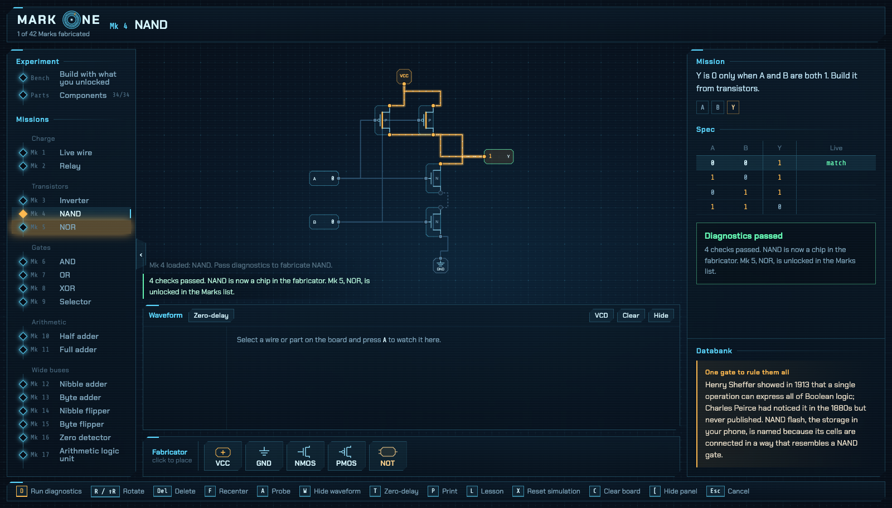
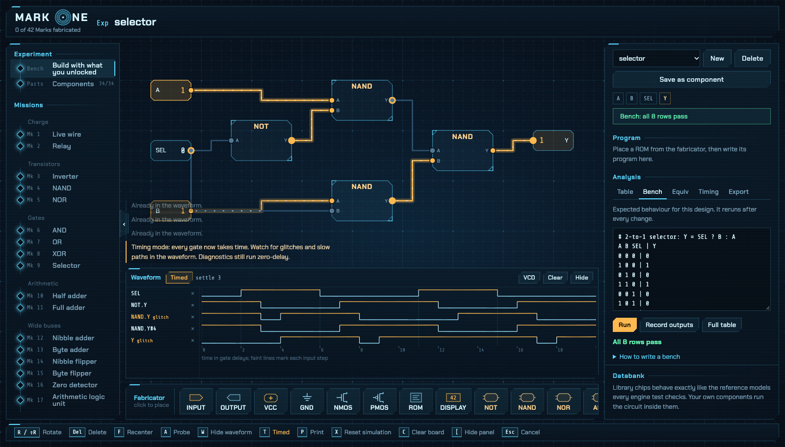
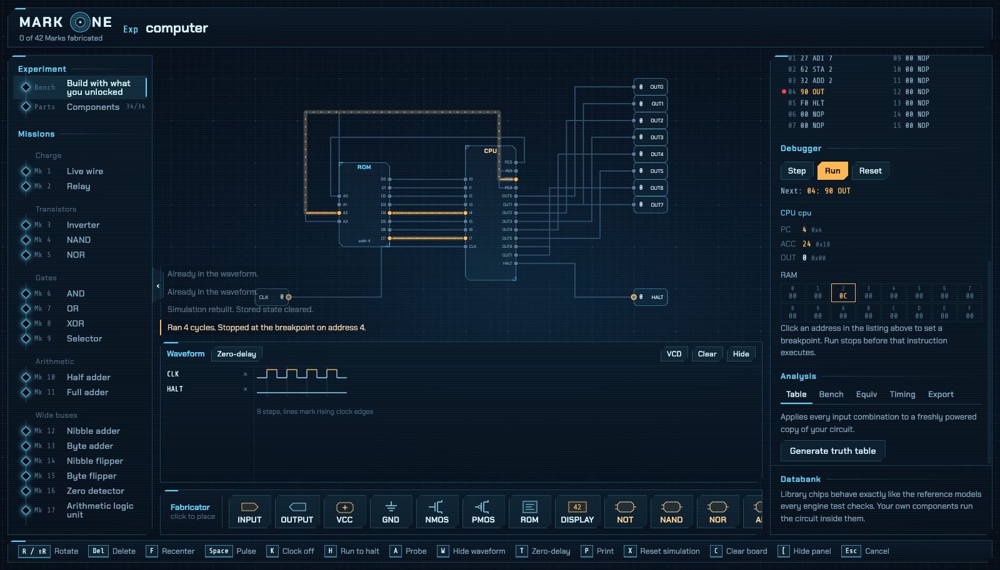
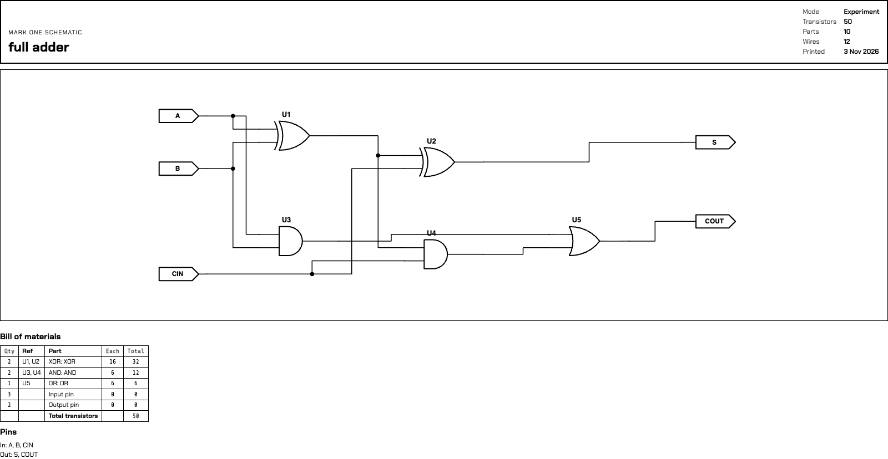

<p align="center">
  
</p>

# Mark One

A game about building a computer from transistors up, on top of a real circuit engine written in Rust.

Forty-two Marks take you from a live wire to NAND gates, adders, memory, a CPU and programs running on the computer you built.

<table>
  <tr>
    <td width="50%"></td>
    <td width="50%"></td>
  </tr>
  <tr>
    <td></td>
    <td></td>
  </tr>
</table>

## Quick Start

```bash
# 1. Build and run (Rust 1.85+)
cargo run --release

# 2. Open the app
open http://127.0.0.1:7878

# 3. Run the tests
cargo test --release --workspace
```

| Env var | Default | Effect |
|---------|---------|--------|
| `PORT` | `7878` | HTTP port |
| `MARK_ONE_SAVE` | `mark_one_save.json` | Progress, drafts and designs |
| `UNLOCK_ALL` | off | `1` opens every Mark and chip |

## How to Play

1. Pick a Mark from the left panel. A one-card lesson explains the component, never how to build it.
2. Place parts from the fabricator at the bottom, then click pin to pin to wire them.
3. Toggle inputs and pulse the clock to test it live. Gold wires carry 1, steel wires 0.
4. Press **D** to run diagnostics. A pass turns your circuit into a chip for every later Mark.

**Experiment** (Bench in the left panel) is free build: anything you've unlocked, with your own pins, test benches, equivalence checks, timing and export.

## What's Included

| Feature | What it does |
|---------|--------------|
| Missions | 42 Marks, each checked by diagnostics before it unlocks the next |
| Experiment | Build anything from unlocked parts and save designs as components |
| Waveform | Probe wires and watch them as timing traces, export to VCD |
| Test benches | Expected input/output rows, rerun after every change |
| Equivalence | Prove two designs behave the same |
| Timing mode | Gate delays, glitches, setup problems and critical paths |
| Debugger | Step, breakpoints, live registers and RAM |
| Export | Verilog and KiCad netlists |
| Print | Schematic sheets with standard symbols |

## Progression

| Chapter | Marks | You build |
|---------|-------|-----------|
| Charge | 1-2 | Live wire, relay |
| Transistors | 3-5 | NOT, NAND, NOR from NMOS and PMOS |
| Gates | 6-9 | AND, OR, XOR, selector |
| Arithmetic | 10-17 | Half and full adders, 4- and 8-bit adders, ALU |
| Memory | 18-24 | Latches, flip-flop, registers, accumulator |
| Counting and decoding | 25-30 | Incrementer, program counter, decoders |
| Memory banks | 31-34 | 2 to 16 bytes of RAM |
| The CPU | 35-37 | Control unit, CPU, the computer |
| Software | 38-42 | Programs on your own computer, then a free workshop |

## The Instruction Set

One byte per instruction: opcode in the high 4 bits, operand `n` in the low 4. 16 bytes of ROM, 16 bytes of RAM, one 8-bit accumulator.

| Op | Hex | Does |
|----|-----|------|
| LDI n | 1n | ACC = n |
| ADI n | 2n | ACC = ACC + n |
| ADD n | 3n | ACC = ACC + RAM[n] |
| SUB n | 4n | ACC = ACC - RAM[n] |
| LDA n | 5n | ACC = RAM[n] |
| STA n | 6n | RAM[n] = ACC |
| JMP n | 7n | PC = n |
| JZ n | 8n | If ACC is 0, PC = n |
| OUT | 90 | OUT = ACC |
| HLT | F0 | Stop |
| NOP | 00 | Nothing |

Select a ROM on the board to write assembly. Labels end with a colon and comments start with `;`.

## Controls

| Key | Does |
|-----|------|
| D | Run diagnostics |
| Space / K | Pulse the clock / clock speed |
| H | Run to HLT or a breakpoint |
| A / W | Probe a wire / show the waveform |
| T | Timing mode |
| R / Del | Rotate / delete the selected part |
| P | Print the schematic |
| X / C | Reset the simulation / clear the board |

Right-click deletes, drag the floor to pan, scroll to zoom.

## Architecture

- **Switch-level transistors**: NMOS and PMOS simulated as switches, in the style of IRSIM, with weak values for pass transistors and charge that leaks away
- **Behavioural chips**: every verified component runs as a tested model, so even the 12,000-transistor CPU simulates instantly
- **Race checks**: diagnostics run every circuit with chips evaluated in both orders, so designs that rely on a glitch fail
- **Tested from MOSFETs up**: the basic gates are proved from transistors, and every Mark has a reference solution that must pass
- **Verified export**: the Verilog for every library chip is checked against the engine in [Icarus Verilog](https://steveicarus.github.io/iverilog/) (`brew install icarus-verilog`)
- **One binary**: the web view is embedded at build time, no build step for the front end

## Limitations

- Timing mode counts gate delays, not nanoseconds. It finds glitches and slow paths, not real timing closure.
- Library memories power up at 0; real ones power up unknown.

## Project Structure

```
mark-one/
├── crates/
│   ├── engine/      # simulator, components, analysis, export
│   ├── course/      # the 42 Marks and diagnostics
│   └── server/      # the mark-one binary and JSON API
├── web/             # the view: plain ES modules and CSS
└── docs/images/     # README pictures
```

## License

[MIT](LICENSE) © 2026 Sbonelo Mntungwa

## Contributing

This repository doesn't take pull requests. To report a bug or suggest a change, please [open an issue](https://github.com/Sbonelo-Mntungwa/mark-one/issues/new). See [CONTRIBUTING.md](CONTRIBUTING.md).
